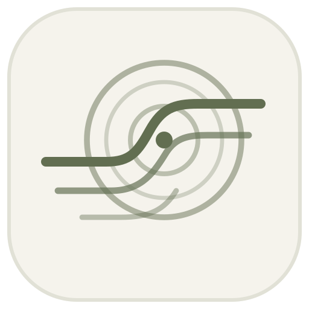

<p align="center">
  
</p>

<div align="center">

# Almusic Player

**桌面音乐播放器 · 酷狗云端歌单同步 · 多音源播放 · 沉浸式歌词**

[](https://github.com/mysterious-shhr/Almusic-player/releases)
[](LICENSE)
[](https://vuejs.org/)
[](https://www.typescriptlang.org/)
[](https://www.electronjs.org/)

</div>

## 项目介绍

Almusic Player 基于 [Zephyrus Player](https://github.com/cang-dot/zephyrus-player) 继续开发；Zephyrus Player 又基于 [AlgerMusicPlayer](https://github.com/algerkong/AlgerMusicPlayer)。项目保留原有的网易云音乐、本地音乐、逐字歌词和多种全屏视觉，在此基础上增加酷狗账号扫码登录、云端歌单同步、收藏库管理、播放匹配与手动选版，以及 Windows 任务栏控制。

项目名称为 **Almusic Player**，软件显示名称为 **Almusic**。0.1.1 源码统一窗口、托盘、开屏、移动页面、远程控制页面和新构建安装 / 卸载器的名称，并替换应用、更新对话框、浏览器 / PWA、Windows ICO 和 macOS ICNS 的品牌图标。已有安装器的内嵌安装脚本需重新打包才能更新。

这个分支的重点是：把已经整理好的酷狗歌单带到桌面播放器中，保留来源歌曲信息，并在一个界面完成浏览、排序、搜索和播放。Almusic Player 是独立社区项目，与网易云、酷狗等音乐平台没有官方隶属关系。项目地址：[mysterious-shhr/Almusic-player](https://github.com/mysterious-shhr/Almusic-player)。

## 本分支增加了什么

### 酷狗扫码登录与云端歌单同步

- 使用酷狗手机 App 扫码并确认登录，在桌面端查看“我喜欢”“我创建的”“我收藏的”歌单。
- 分页读取歌单目录和曲目，结合账号接口与公开歌单接口返回的曲目；支持同步全部歌单、刷新单个歌单和显示同步进度。
- 同步时检测重复页、接口报错和数量差异。出现异常会保留已读取数据及可用旧缓存，并提示列表可能不完整。
- 兼容后续目录页返回成功空尾页的情况；不会把失败响应或缺字段响应当成正常空列表。
- 新增模块用于读取云端数据和获取播放信息，页面排序、选版和本机收藏不会改写酷狗云端歌单。

### 收藏库与长歌单工具

- 歌单卡片与详情页采用纸白、橄榄色和唱片线条的视觉风格，适配浅色、深色和窄窗口。
- 在当前歌单中组合搜索歌名、歌手、专辑；例如“晴天 周杰伦”会同时匹配两个关键词。
- 支持默认顺序及倒序、添加时间、歌曲名、歌手、专辑、时长、播放次数（本机）和随机排序。
- “播放全部”“播放搜索结果”、批量选择和加入队列沿用当前显示顺序；无有效播放标识的条目会在入队时跳过。
- 支持舒展 / 紧凑列表、虚拟滚动、吸顶工具栏、回到顶部和定位当前歌曲；排序与列表密度偏好可保存。
- “本机收藏”保存整张酷狗歌单的快捷入口，并按酷狗账号区分；它与平台上的“我收藏的”歌单是不同分类。

### 播放回退与手动选版

- 默认优先尝试酷狗原曲播放路径。解析失败时搜索网易云和 GD 音乐台候选，核对歌名、已知歌手、版本词及双方提供的时长。
- 匹配时去掉歌名末尾的 `.mp3`、`.flac` 等音频扩展名，保留 Live、Remix 等版本信息；显示歌名和云端歌单不变。
- 多个备用来源并行搜索，在限定时间内尝试候选；拒绝接口明确标注的试听地址，但无法保证所有平台都正确标注试听或提供相同版本。
- 音频地址加载失败时尝试替代地址，并暂时避开相同失败地址；切歌和暂停会阻止旧播放请求继续启动。
- 可从歌单进入音源搜索，先试听，再点击“用于原歌单”保存选定版本；也可“恢复自动匹配”。选版仅保存本机的歌曲目录标识与必要信息，不保存签名音频地址。

### 本机单曲收藏

- 酷狗、QQ 等跨平台单曲可通过播放栏或任务栏加入本机收藏，在“播放历史与收藏”中查看、播放或取消。
- 本机单曲收藏保存歌名、歌手、专辑及必要播放标识；网易云歌曲继续沿用原有账号收藏行为。
- 单曲收藏与整张歌单的快捷收藏分别管理。旧版本仅有字符串 ID、没有歌曲详情的收藏可能无法恢复显示。

### 界面、图标与 Windows 任务栏

- 侧栏悬停时展开导航与歌单名称，离开时收起；点击 Logo 可固定展开。
- 唱片与风线开屏支持自动结束、跳过和 Esc，并遵循“关闭动效”及系统减少动态效果设置。
- 统一侧栏、窗口、托盘、更新 / 安装对话框、浏览器 / PWA、程序及安装 / 卸载器品牌图标；Windows 图标包含 16–256 像素尺寸，macOS 图标包含 16–1024 像素及高分辨率表示。
- Windows 任务栏缩略图工具栏提供上一首、播放 / 暂停、下一首、收藏四个按钮，随当前歌曲和状态更新。
- 等待 Windows 实际创建任务栏按钮后再提交工具栏，避免冷启动时过早提交导致按钮缺失。
- Windows x64 可显示独立歌曲信息卡；原生预览不可用时回退到普通窗口预览。信息卡在现有主进程中绘制，不启动独立辅助进程，也不下载封面。

## 继承的播放器功能

以下能力来自 Zephyrus Player / AlgerMusicPlayer，属于这个项目的基础功能，而不是本分支首次实现。

| 方向     | 当前保留的功能                                                                  |
| -------- | ------------------------------------------------------------------------------- |
| 音乐内容 | 网易云音乐歌单、专辑、歌手、播客、MV、电台；本地文件夹扫描与元数据管理          |
| 多音源   | 多平台解析与回退、LX Music 音源脚本、自定义音乐 API                             |
| 歌词     | YRC 逐字歌词、翻译与罗马音、时间偏移、本地 TTML / LRC 绑定、内嵌歌词提取        |
| 桌面歌词 | 独立透明窗口、置顶与锁定、滚动 / 单行 / 双行模式                                |
| 全屏视觉 | 默认、舞台、杂志、狂躁、诡谲、陈旧六种样式；GSAP 动画、封面取色、高潮和鼓点检测 |
| 音频控制 | 10 段均衡器、变速、下一曲预加载、输出设备切换、睡眠定时器、系统媒体键           |
| 桌面交互 | 深色 / 浅色主题、迷你播放器、系统托盘、自定义全局快捷键、可选局域网远程控制     |
| 本地管理 | 艺术家 / 专辑分组、碟号与音轨排序、拼音搜索、播放历史和缓存                     |
| 扩展能力 | 社区高潮 / 重点词 / 歌词数据、可选歌词 AI 分析、插件系统                        |

在线内容、社区服务、自定义音源及 AI 服务的可用性取决于对应第三方服务和配置。部分新增页面使用中文文案；原有多语言支持不代表新增功能已完成全部语言翻译。

## 使用酷狗歌单

1. 在桌面版左侧进入“酷狗歌单”，点击登录。
2. 使用酷狗手机 App 的扫一扫，并在手机上确认。
3. 点击“同步全部歌单”，检查同步提示及各分类。
4. 打开歌单，可以双击歌曲、播放当前列表、加入队列或刷新。
5. 播放失败或版本不合适时，进入音源搜索，试听后选择“用于原歌单”。

只保存在酷狗客户端本机的歌单，需要先在官方客户端同步到酷狗云端。

## 限制与验证范围

- **同步完成不等于与客户端完全相同。** 完整性标记针对接口返回的数据；平台隐藏、下架、未上传或未返回的条目仍可能缺失。出现数量差异时请对照官方客户端并再次刷新。
- **同步到的歌曲不保证可播放。** 版权、地区、账号权益、音质权限、平台接口变化及第三方服务状态都可能影响播放；音质也可能回退。
- **自动匹配可能有误。** 相同歌名、翻唱、上传者命名和缺失时长可能影响结果。需要特定版本时请试听并手动选版。
- **添加时间来自歌单曲目接口。** 收藏的公开歌单可能显示原作者添加曲目的时间，不是收藏整张歌单的时间；缺失时间排在末尾。
- **本机播放次数不是酷狗账号听歌统计。** 它来自播放器本机最多 500 首的历史记录，计数沿用播放请求语义；清理或淘汰历史会影响排序。
- **平台范围。** 酷狗登录和同步依赖 Electron 桌面主进程，Web 模式不提供这部分能力。任务栏按钮限 Windows，独立信息卡限 Windows x64；macOS / Linux 保留上游构建入口，本分支新增能力尚未完成这些平台的实际验收。
- **验证范围。** 0.1.0 发布准备时，`npm test` 的 10 组离线测试共 147 项通过，生产构建、5 组专项类型检查及 3 组 UI 回归通过。隔离测试及构建成功不能替代真实账号歌单核对、实际音频输出或 Windows 任务栏外观验收。全量 Node 类型检查仍有 7 项、Web 类型检查仍有 186 项既有诊断，不能将专项检查通过表述为全量检查通过。

  0.1.1 更名维护已通过生产构建、11 组离线回归共 151 项和图标格式 / 尺寸核验；新增的 4 项回归使用虚拟目录检查已有用户数据的选择，全量 Node 类型检查仍为上述 7 项既有诊断。详见 [验证记录](docs/verification.md)。

## 隐私与本机数据

新增酷狗凭据由 Electron 主进程管理，账号和歌单缓存使用系统支持的 `safeStorage` 加密。安全存储不可用时仅保存在本次运行内存中；Linux 的 `basic_text` 后端不被视为安全存储。

退出酷狗会删除新增的本机酷狗账号与同步缓存文件。歌单快捷收藏、单曲收藏、显示偏好和手动选版属于本机偏好，可能继续保留。上游其他账号配置与缓存采用各自的存储方式，不能一概视为加密。

播放回退会把歌名、歌手等搜索信息发送给对应音乐服务；社区功能、AI 分析和自定义音源也可能访问外部服务。详细的数据范围、保存方式及反馈时的脱敏建议见 [隐私说明](docs/privacy.md)。

0.1.1 移除继承的页面百度统计脚本。新安装使用 `Almusic` 用户数据目录；已有 `Almusic` 目录时优先使用，否则发现原来的 `ZephyrusPlayer` 目录会沿用它，避免改名造成账号、歌单和设置丢失。改名不会复制账号文件到项目目录。公开源码应排除真实用户数据、日志、备份、二维码、个人截图及环境凭据，保留上游署名和许可证。

## 下载与开发

**当前版本为 0.1.3。** 从 [Releases](https://github.com/mysterious-shhr/Almusic-player/releases) 的 Assets 下载对应系统的 Almusic 安装包。发布流程在 Windows、macOS 和 Linux 构建环境生成安装包，检查应用资源的隐私与更新清单，再汇总发布；某个标签是否已完成构建，以该 Release 实际列出的文件及 [构建记录](https://github.com/mysterious-shhr/Almusic-player/actions/workflows/release.yml) 为准。

| 系统 | 架构 | 下载文件 |
| --- | --- | --- |
| Windows | x64（大多数 Intel / AMD 电脑） | `Almusic-0.1.3-win-x64.exe` |
| Windows | ia32（32 位） / ARM64 | 对应 `win-ia32.exe` / `win-arm64.exe` |
| macOS | Intel x64 / Apple Silicon ARM64 | 对应 `mac-x64.dmg` / `mac-arm64.dmg`，也提供 ZIP |
| Linux | x64 / ARM64 | 对应架构的 `.AppImage`、`.deb` 或 `.rpm` |

`.blockmap` 和 `latest*.yml` 供自动更新使用，无需手动安装；`SHA256SUMS.txt` 用于核对下载文件。GitHub 自动生成的 Source code ZIP / tar.gz 是源码，不是安装包。Windows 和 macOS 安装包没有商业代码签名，macOS 没有 Apple 公证；系统可能提示未识别的发布者，下载时请核对本仓库和校验和。

打包不包含本机账号、歌单缓存、安装备份、审计目录或环境凭据。跨平台构建和资源检查通过不能代替实际播放、真实账号或所有设备的功能验收；Windows 任务栏信息卡仍仅支持 x64。上游安装包不包含本分支的新增功能。

开发建议使用 Node.js 22 LTS（至少 22.12）；构建工具也支持 Node.js 20.19 及以上的 20.x 版本。

```bash
git clone https://github.com/mysterious-shhr/Almusic-player.git
cd Almusic-player
npm ci
npm run dev          # Electron 桌面开发
npm run dev:web      # Web 开发，需要单独配置音乐 API
npm run build        # 构建主进程、预加载脚本和渲染进程
npm run build:win    # Windows 安装包
npm test             # 11 组离线回归
```

更多构建、模块说明与测试命令见 [DEV.md](DEV.md)，变更记录见 [CHANGELOG.md](CHANGELOG.md)，自定义音源说明见 [docs/custom-api-readme.md](docs/custom-api-readme.md)。

## 技术栈

Electron 40 · Vue 3.5 · TypeScript 5.9 · electron-vite 5 / Vite 6 · Naive UI · Tailwind CSS / SCSS · Pinia · GSAP · OGL · Howler.js / Web Audio API · music-metadata。

## 许可证与致谢

本项目按 [MIT License](LICENSE) 发布，保留上游版权声明。第三方代码与资源遵循各自的许可证。

- [Zephyrus Player](https://github.com/cang-dot/zephyrus-player) — 本分支的直接基础，感谢 Zephyrus / cang-dot。
- [AlgerMusicPlayer](https://github.com/algerkong/AlgerMusicPlayer) — 原始播放器项目，感谢 algerkong 及贡献者。
- [KuGouMusicApi](https://github.com/MakcRe/KuGouMusicApi) — 酷狗只读协议参数与签名实现参考，出处及 MIT 声明见 [NOTICE](src/main/kugou/NOTICE.md)。
- [GSAP](https://gsap.com/)、[Naive UI](https://www.naiveui.com/)、[OGL](https://github.com/oframe/ogl)、[Howler.js](https://howlerjs.com/)、[music-metadata](https://github.com/Borewit/music-metadata) 及其他依赖的维护者。
